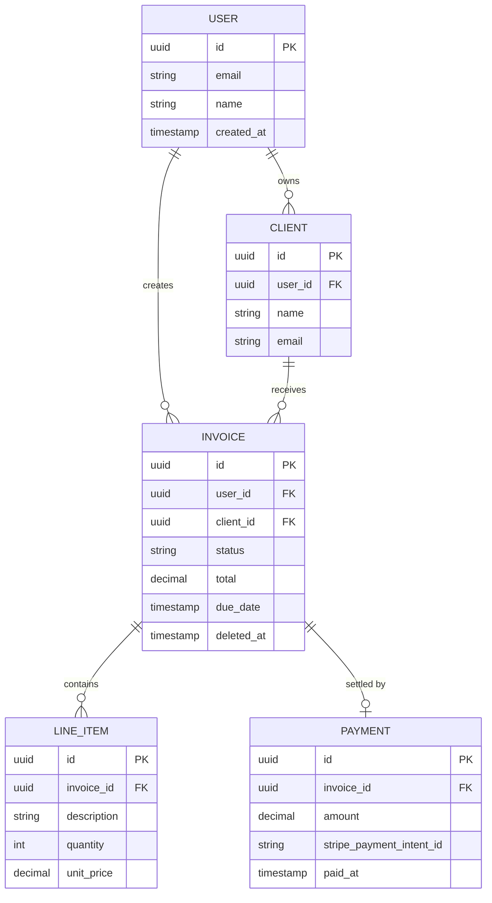

# Data Model Overview

Before writing schema migrations, map the core entities and their relationships at a whiteboard level. This exercise forces clarity on what the product actually stores, prevents redundant tables, and reveals foreign key decisions before they're expensive to change. The output of this document is an entity map that becomes the first input to [database/schema-design.md](../data/schema-design.md).

## Identifying Entities

Read the requirements document and extract the nouns — things the product stores, retrieves, or acts upon. Filter out UI concepts ("page," "form") and actions ("submit," "send"). What remains are candidate entities.

**Example — invoicing product:**

Nouns from requirements: user, client, invoice, line item, payment, email, notification

Filter: email (action/transport, not stored entity), notification (yes — stored for the panel)

Candidate entities: `user`, `client`, `invoice`, `line_item`, `payment`, `notification`

**Evaluate each candidate:**
- Does it have attributes of its own (beyond a foreign key and a name)? If not, it may belong as columns on another entity.
- Does it need its own lifecycle (create, update, delete independently)? If not, it may be a child record.

`line_item` has its own attributes (description, quantity, unit price) and depends on an invoice → keep as a child entity. `payment` records actual received payments with amounts and timestamps → keep as its own entity.

## Entity Relationship Diagram

Use Mermaid for version-controlled diagrams, or ASCII for quick sketching.

**Mermaid example:**

## Key Decisions to Note

For each relationship, note the cardinality and the cascade behavior:

| Relationship | Cardinality | On parent delete |
|---|---|---|
| user → client | one-to-many | soft delete clients |
| user → invoice | one-to-many | soft delete invoices |
| client → invoice | one-to-many | nullify client_id (client deleted, invoices preserved) |
| invoice → line_item | one-to-many | cascade delete |
| invoice → payment | one-to-one | preserve payment record |

## Handoff to Schema Design

This entity map becomes the input for [database/schema-design.md](../data/schema-design.md), which adds:
- Standard columns (`id`, `created_at`, `updated_at`, `deleted_at`)
- Row-level security policies
- Index strategy
- The soft-delete default and hard-delete exception rules

Do not finalize column types or indexes here. This document answers "what are the entities and how do they relate?" — schema design answers "how exactly is that stored?"

## Related Documents

- [Requirements](requirements.md)
- [Database schema design](../data/schema-design.md)
- [Database choosing](../data/choosing.md)
